# SuperApp

Plataforma de gestión residencial: control de acceso con pases QR, portería,
notificaciones y citofonía para conjuntos residenciales. Un solo front
(`front/`) y un microservicio por feature (`back/<feature>/ms` + su `db/`),
todo detrás del API Gateway (`back/api-gateway`).

| Iniciar sesión | Elegir conjunto |
|---|---|
| 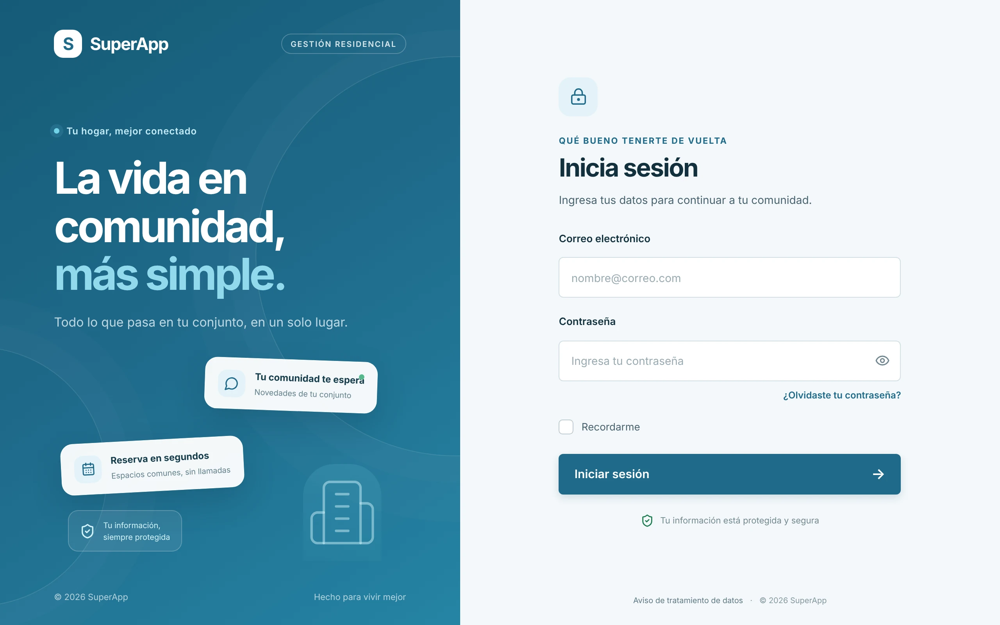 | 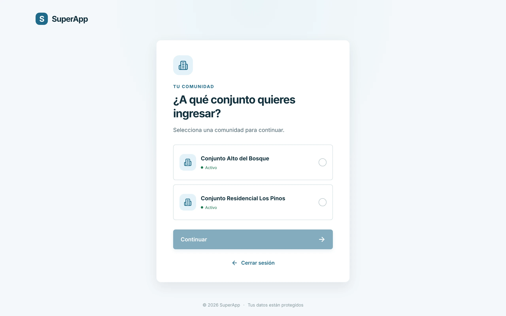 |
| **Residente: inicio** | **Residente: pase de acceso QR** |
| 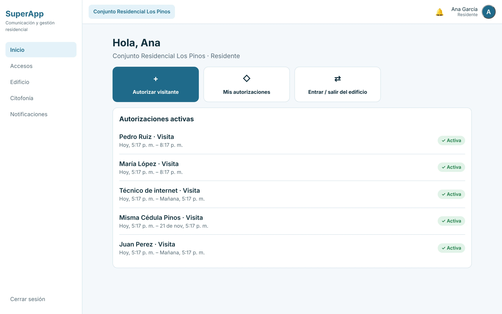 | 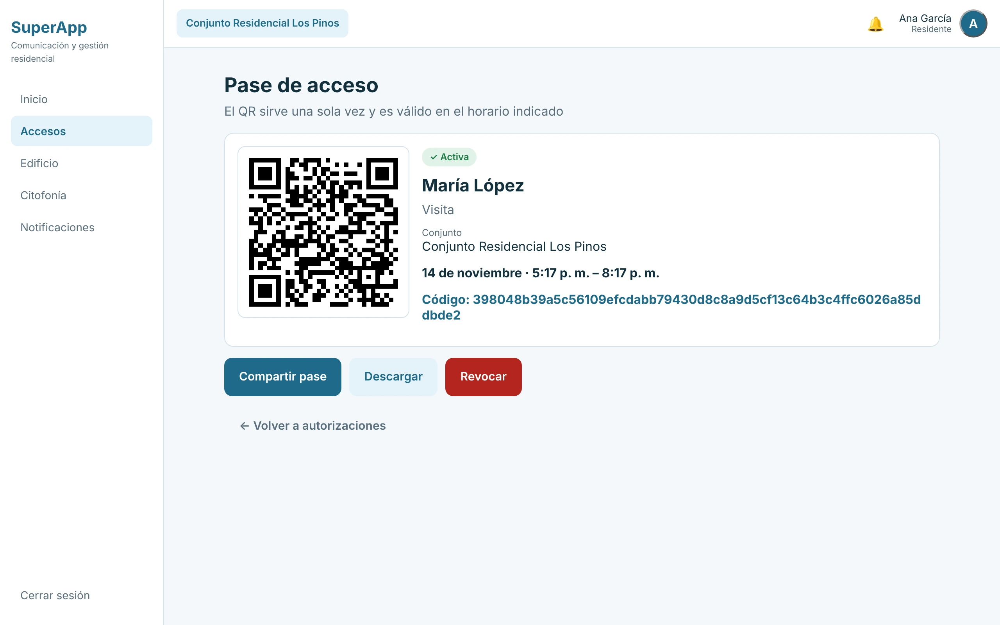 |
| **Portería: pase validado** | **Notificaciones** |
| 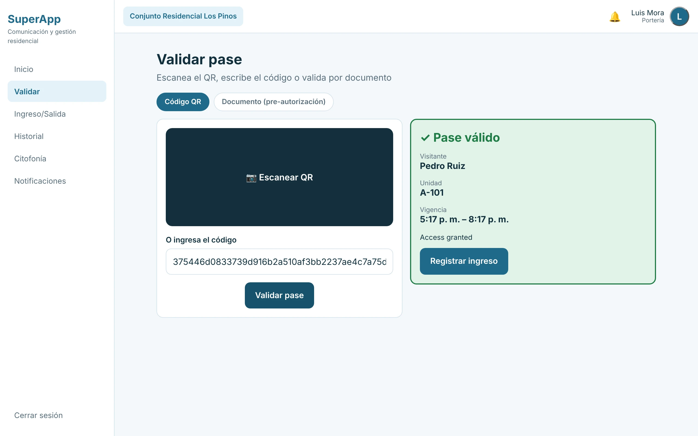 | 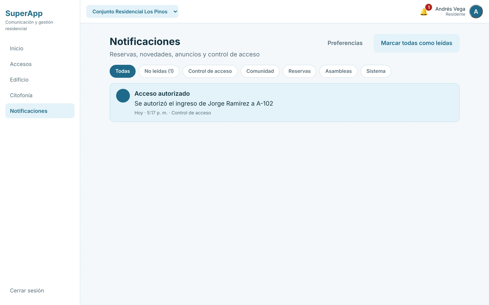 |

Las capturas son del stack local (`docker compose up`) con los datos demo:
Ana autoriza a sus visitantes, Luis (portería) valida el código del pase y
Andrés recibe la notificación cuando Sofía, de su misma unidad, autoriza una
visita (control-de-accesos → notificaciones).

## Levantar todo con un comando

Requisito: Docker con Compose v2.

```sh
docker compose up --build
```

La primera vez tarda unos minutos (compila las imágenes). Luego abre
**http://localhost:3000**.

| Usuario (contraseña `Demo-Pass-2026!`) | Rol |
|---|---|
| `ana.garcia@demo.test` | residente · Los Pinos |
| `luis.mora@demo.test` | portería · Los Pinos |
| `carlos.rojas@demo.test` | administración · Los Pinos |
| `sofia.diaz@demo.test` | residente en dos conjuntos |

También está `/dev-login` para entrar como cualquier persona/rol sin contraseña.

## Arquitectura actual

Lo que hay hoy en el repositorio y levanta `docker-compose.yml`:

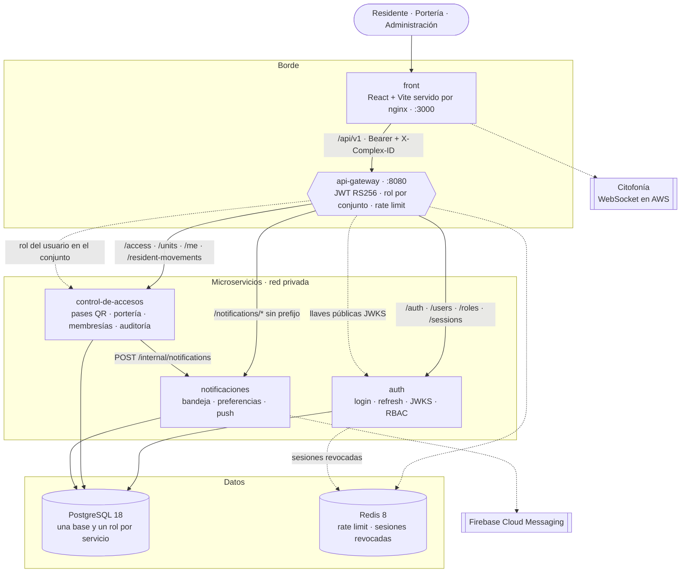

Cómo viaja una petición:

1. El front solo conoce `/api/v1`; nginx la reenvía al **api-gateway**.
2. El gateway borra los headers de identidad que mande el cliente, valida el JWT
   RS256 de auth con su JWKS y rechaza los de sesiones cerradas (Redis).
3. Si llega `X-Complex-ID`, pregunta a control-de-accesos el rol real del
   usuario en ese conjunto (caché 60 s). Si no pertenece: `403`, sin llegar al servicio.
4. Reenvía con `X-User-ID`, `X-Complex-ID`, `X-Complex-Role` y un
   `X-Gateway-Secret` distinto por servicio. Los servicios solo confían en esos headers.
5. Entre servicios no hay bus: llamadas HTTP a `/internal/*` con
   `X-Internal-Secret`, idempotentes por `event_id`. El gateway nunca enruta `/internal/*`.

Detalle: [`docs/architecture.md`](docs/architecture.md) ·
contrato del gateway: [`docs/api-gateway.md`](docs/api-gateway.md) ·
APIs internas: [`docs/internal-apis.md`](docs/internal-apis.md) ·
eventos: [`docs/events.md`](docs/events.md).

## Arquitectura objetivo

Diagramas de diseño por dominio (anexos de la entrega 2). Describen hacia dónde
va la plataforma; **no todo está implementado**. La tabla dice qué existe hoy.

| Dominio | Diagrama |
|---|---|
| Plataforma, seguridad y cumplimiento | [plataforma-seguridad.webp](docs/architecture/target/plataforma-seguridad.webp) |
| Control de acceso | [control-de-acceso.webp](docs/architecture/target/control-de-acceso.webp) |
| Citofonía | [citofonia.webp](docs/architecture/target/citofonia.webp) |
| Gestión financiera | [gestion-financiera.webp](docs/architecture/target/gestion-financiera.webp) |
| Comunidad e inteligencia asistida | [comunidad.webp](docs/architecture/target/comunidad.webp) |

<details>
<summary>Ver los cinco diagramas</summary>

### Plataforma, seguridad y cumplimiento
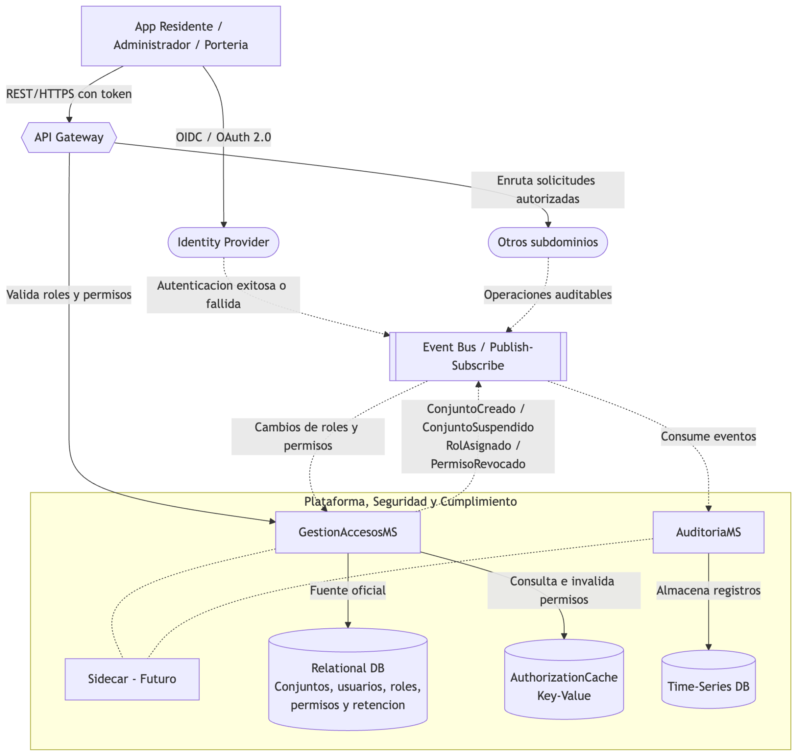

### Control de acceso
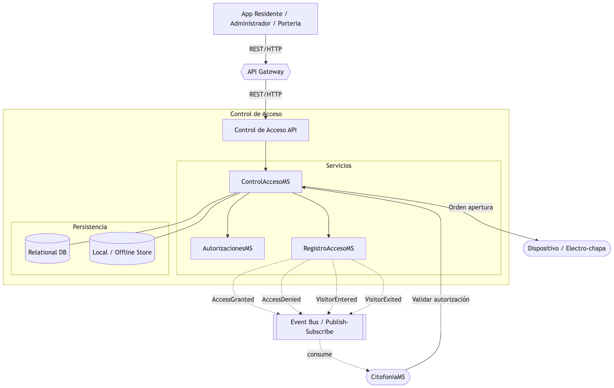

### Citofonía
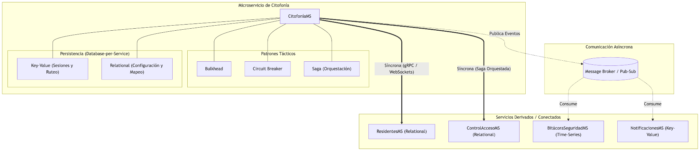

### Gestión financiera
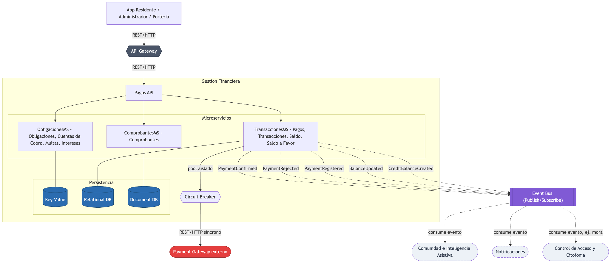

### Comunidad e inteligencia asistida
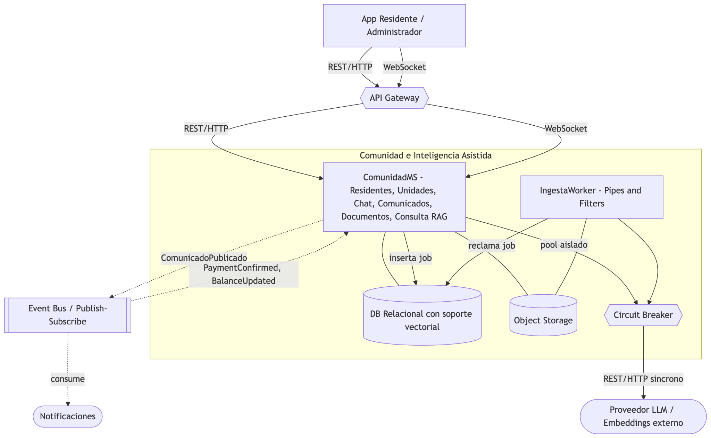

</details>

### Del objetivo al código

✅ implementado · 🟡 parcial o con otra forma · ⬜ pendiente

| Componente del diseño | Estado | En el repositorio |
|---|---|---|
| API Gateway | ✅ | `back/api-gateway`: authN, rol por conjunto, rate limit, bloqueo de `/internal` |
| Identity Provider (OIDC / OAuth 2.0) | 🟡 | `back/auth`: JWT RS256 + JWKS, refresh rotativo, RBAC. Sin flujo OIDC completo |
| Gestión de accesos (roles y permisos) | 🟡 | RBAC en auth + membresías por conjunto en control-de-accesos |
| AuthorizationCache (key-value) | 🟡 | caché de roles en memoria del gateway (60 s); Redis para sesiones revocadas |
| Auditoría | 🟡 | `audit_log` de solo inserción en control-de-accesos (PostgreSQL, no time-series) |
| Event Bus / publish-subscribe | ⬜ | hoy, HTTP interno idempotente (`POST /internal/notifications`) |
| Control de acceso · autorizaciones · registro | 🟡 | un solo servicio, `back/control-de-accesos`: pases QR, pre-autorizaciones, portería, entradas y salidas |
| Circuit breaker del sistema QR | ✅ | `control-de-accesos/ms/internal/qrsystem` |
| Almacén offline · electro-chapa | ⬜ | — |
| Notificaciones | ✅ | `back/notificaciones`: bandeja, preferencias, push FCM |
| Citofonía | 🟡 | módulo del front sobre un WebSocket de AWS API Gateway; sin microservicio propio en el repo |
| Gestión financiera | ⬜ | — |
| Comunidad e inteligencia asistida (RAG) | ⬜ | — |

## Qué levanta `docker compose`

| Servicio | Qué hace |
|---|---|
| `postgres` | un servidor, una base y un rol por `ms` |
| `redis` | rate limiting del gateway y sesiones revocadas (logout inmediato) |
| `auth-init`, `control-de-accesos-migrate`, `notificaciones-migrate` | tareas de una vez: llave RS256, migraciones y datos demo (idempotentes) |
| `auth`, `control-de-accesos`, `notificaciones` | microservicios, solo en la red interna |
| `api-gateway` | único punto de entrada a la API |
| `front` | build de producción de Vite servido por nginx, que reenvía `/api` al gateway |

Solo `front` (3000), `api-gateway` (8080) y `postgres` (5440) publican puertos,
y solo en `127.0.0.1`.

## Verificarlo

```sh
scripts/smoke.sh   # 30+ comprobaciones de punta a punta contra el stack (curl + jq)
```

Antes de un merge: los tests de cada servicio (`go test -race ./...`), los del
front (`npm run lint && npm test`) y este smoke test contra el stack.

## Comandos útiles

```sh
docker compose logs -f api-gateway        # ver el tráfico
docker compose up --build api-gateway     # recompilar un servicio
docker compose down                       # parar (conserva los datos)
docker compose down -v                    # parar y borrar datos y llaves
```

**Front con hot reload** contra el stack: `cd front && GATEWAY_URL=http://localhost:8080 npm run dev`
(http://localhost:5173).

**Secretos:** todos tienen un valor por defecto **solo para local**. Para
cambiarlos, copia `.env.example` a `.env`. Producción usa los
`docker-compose.prod.yml` de cada feature.

## Fuera del stack local

- **Citofonía** usa un WebSocket de AWS (`VITE_INTERCOM_WS_URL` en `front/.env.production`).
- **Push (FCM)** está apagado sin credenciales de Firebase: las notificaciones
  llegan a la bandeja de la app (ver `back/notificaciones/README.md`).

## Estructura

```
back/
  api-gateway/          gateway (Go, sin base de datos)
  auth/                 identidad y tokens        · ms/ + db/
  control-de-accesos/   pases, portería, membresías · ms/ + db/
  notificaciones/       bandeja y push            · ms/ + db/
front/                  React + Vite, un módulo por feature
infra/docker/           init de PostgreSQL para el stack local
scripts/smoke.sh        prueba de punta a punta
docs/                   arquitectura, contratos, diagramas y capturas
```
