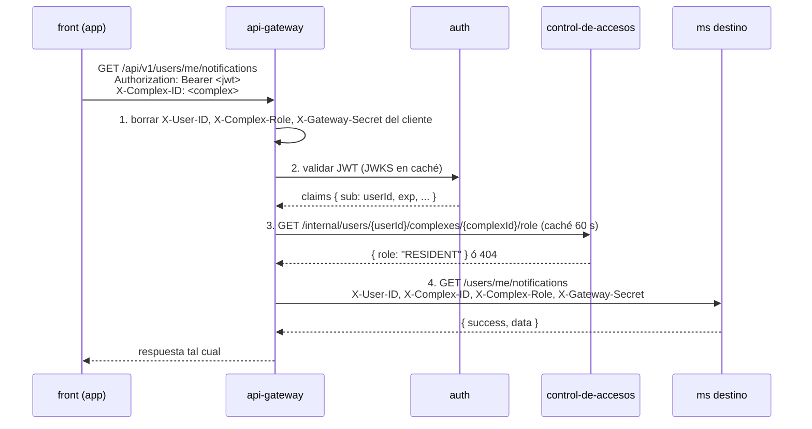

# API Gateway — especificación

Estado: **por implementar**. Este documento es el contrato que el gateway debe
cumplir para que los microservicios (empezando por `notificaciones`) funcionen
detrás de él. Los `ms` **no validan tokens**: confían en lo que el gateway les
dice, así que cada regla de aquí es una regla de seguridad.

## Responsabilidades

1. **Punto de entrada único.** El frontend solo conoce la URL del gateway
   (`/api/v1/...`). Los `ms` viven en una red privada y no son accesibles desde
   internet.
2. **Autenticación.** Valida el JWT emitido por `auth` en cada petición.
3. **Autorización de conjunto.** Si la petición trae `X-Complex-ID`, verifica
   con `control-de-accesos` que el usuario pertenece a ese conjunto y obtiene
   su rol.
4. **Identidad de confianza.** Elimina los headers de identidad que mande el
   cliente e inyecta los suyos.
5. **Enrutamiento** por prefijo hacia cada `ms`.
6. **Protección.** Rate limiting, límite de tamaño del body, timeouts, CORS.
7. **Bloqueo de rutas internas.** Nunca reenvía `/internal/*`.

El gateway **no tiene base de datos** (ver `architecture.md`). Solo usa caché
en memoria o Redis.

## Flujo de una petición



### 1. Limpiar headers del cliente

**Antes de cualquier otra cosa** el gateway borra de la petición entrante:
`X-User-ID`, `X-Complex-Role`, `X-Gateway-Secret` y cualquier `X-Internal-*`.
Si no lo hace, cualquier cliente se hace pasar por otro usuario o por admin.
`X-Complex-ID` sí viene del cliente (es el conjunto seleccionado en la app),
pero **solo** se reenvía después de validarlo en el paso 3.

### 2. Autenticación

- Header `Authorization: Bearer <jwt>`. Sin token o token inválido/expirado → `401`.
- Validación local de la firma con las llaves públicas de `auth`
  (`GET /internal/.well-known/jwks.json`, ver `internal-apis.md`), cacheadas y
  refrescadas cuando aparece un `kid` desconocido. Así el gateway no llama a
  `auth` en cada petición.
- Revocación: `auth` publica los `jti` revocados en Redis
  (`auth:revoked:<jti>` con TTL = expiración del token). El gateway los
  consulta. (El monolito ya tenía este concepto: `TokenDenylist`.)
- Rutas públicas (sin token): `POST /api/v1/auth/login`, `/auth/refresh`,
  `/auth/register` y `GET /healthz`.

### 3. Autorización de conjunto

Si la petición trae `X-Complex-ID`:

1. Validar que sea un UUID → si no, `422`.
2. Consultar el rol: `GET /internal/users/{userId}/complexes/{complexId}/role`
   en control-de-accesos (caché por `(userId, complexId)` de **60 s**).
3. `404` (el usuario no pertenece al conjunto) → responder `403` sin llegar al `ms`.
4. Reenviar `X-Complex-ID` y `X-Complex-Role: <role>`.

Si control-de-accesos no responde → `503` (fail-closed). Nunca reenviar sin rol.

El gateway **no decide** qué rol necesita cada ruta: eso lo hace cada `ms`
(p. ej. un endpoint de administración exige `ADMIN`). El gateway solo
garantiza que el rol reenviado es verdadero.

### 4. Headers hacia los `ms`

| Header | Valor | Siempre |
|---|---|---|
| `X-Gateway-Secret` | secreto compartido con ese `ms` (`GATEWAY_SECRET`) | sí |
| `X-User-ID` | `sub` del JWT | en rutas autenticadas |
| `X-Complex-ID` | conjunto validado | si el cliente lo envió |
| `X-Complex-Role` | `ADMIN` · `RESIDENT` · `GUARD` · ... | si hay `X-Complex-ID` |
| `X-Request-ID` | id de correlación (generar si no viene) | sí |

## Tabla de rutas

El gateway recibe `/api/v1/<ruta>`, quita el prefijo `/api/v1` y reenvía
`<ruta>` al `ms` correspondiente.

### notificaciones (`http://notificaciones:8083`)

| Ruta pública | Método | Requiere `X-Complex-ID` |
|---|---|---|
| `/api/v1/users/me/notifications` | GET | sí |
| `/api/v1/users/me/notifications/unread-count` | GET | sí |
| `/api/v1/notifications/{id}/read` | PATCH | sí |
| `/api/v1/notifications/mark-all-read` | POST | sí |
| `/api/v1/me/notification-preferences` | GET, PUT | no |
| `/api/v1/me/devices` | GET, POST | no |
| `/api/v1/me/devices/unregister` | POST | no |
| `/api/v1/me/devices/{id}` | DELETE | no |

Reglas de prefijo sugeridas: `/users/me/notifications*`, `/notifications*`,
`/me/notification-preferences`, `/me/devices*` → notificaciones. Añadir aquí
las de `auth` y `control-de-accesos` cuando existan.

## Rate limiting y límites

| Alcance | Límite sugerido |
|---|---|
| Por IP, rutas públicas de auth | 10 req/min |
| Por usuario, general | 300 req/min |
| Tamaño del body | 1 MiB (los `ms` también lo limitan) |
| Timeout hacia el `ms` | 30 s |

Contadores en Redis (`ratelimit:<scope>:<id>:<ventana>`) para que funcione con
varias réplicas del gateway. Exceder el límite → `429` con `Retry-After`.

## Errores

Los errores generados por el propio gateway usan el mismo sobre que los `ms`:

```json
{ "success": false, "error": { "code": "AUTH_001", "message": "Authentication required" } }
```

| Caso | HTTP | code |
|---|---|---|
| Sin token / token inválido o revocado | 401 | `AUTH_001` |
| No pertenece al conjunto | 403 | `PERM_003` |
| `X-Complex-ID` mal formado | 422 | `VAL_004` |
| Rate limit | 429 | `SYS_004` |
| `ms` o control-de-accesos caídos | 503 | `SYS_005` |
| Ruta desconocida o `/internal/*` | 404 | `RES_001` |

Las respuestas de los `ms` se devuelven sin modificar.

## Configuración

| Variable | Descripción |
|---|---|
| `AUTH_JWKS_URL` | `http://auth:8081/internal/.well-known/jwks.json` |
| `CONTROL_ACCESOS_URL` | `http://control-de-accesos:8082` |
| `INTERNAL_SECRET` | para llamar a `/internal/*` de otros servicios |
| `NOTIFICACIONES_URL` / `NOTIFICACIONES_SECRET` | destino y `GATEWAY_SECRET` de notificaciones |
| `REDIS_URL` | revocación, rate limit y caché de roles |
| `CORS_ALLOWED_ORIGINS` | orígenes del front web |

Un secreto distinto por `ms` limita el daño si uno se filtra.

## Pruebas de aceptación

Antes de poner el gateway delante de notificaciones, estas pruebas deben pasar:

- [ ] Petición con `X-User-ID` falso y token válido de otro usuario → el `ms` recibe el `X-User-ID` del token.
- [ ] Petición con `X-Complex-Role: ADMIN` de un residente → el `ms` recibe `RESIDENT`.
- [ ] `X-Complex-ID` de un conjunto al que el usuario no pertenece → `403` del gateway, el `ms` no recibe nada.
- [ ] Token expirado o revocado → `401`.
- [ ] `GET /api/v1/internal/...` → `404`.
- [ ] Llamada directa al `ms` sin `X-Gateway-Secret` → `401` (verificado por el `ms`).
- [ ] control-de-accesos caído → `503`, nunca se reenvía sin rol.
- [ ] Superar 300 req/min con el mismo usuario → la siguiente recibe `429`.
