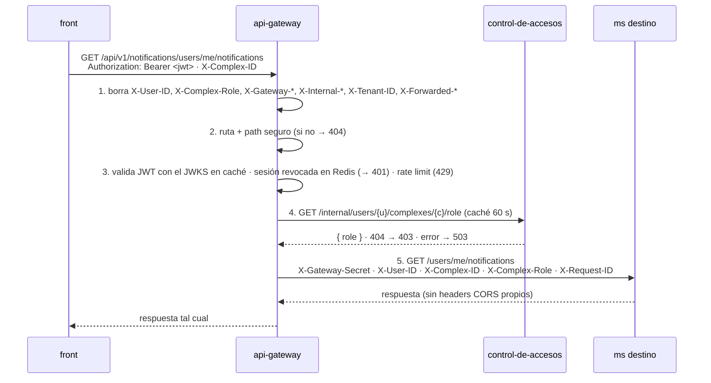

# API Gateway

Estado: **implementado** en `back/api-gateway` (Go, sin base de datos). Este
documento es el contrato entre el front, el gateway y los `ms`. Los `ms`
confían en los headers de identidad que inyecta el gateway, así que cada regla
de aquí es una regla de seguridad. Configuración y pruebas:
[`back/api-gateway/README.md`](../back/api-gateway/README.md).

## Responsabilidades

1. **Punto de entrada único.** El front solo conoce `/api/v1/...`. Los `ms`
   viven en una red privada.
2. **Autenticación.** Valida localmente el JWT RS256 de `auth` con su JWKS.
3. **Autorización de conjunto.** Si llega `X-Complex-ID`, obtiene el rol real
   del usuario en ese conjunto desde `control-de-accesos`.
4. **Identidad de confianza.** Borra los headers de identidad del cliente e
   inyecta los suyos.
5. **Enrutamiento** por prefijo (tabla explícita: lo que no está, es `404`).
6. **Protección.** Rate limiting (Redis), límite de body, timeouts, CORS.
   Rechaza al instante los tokens de sesiones cerradas (logout) en auth.
7. **Bloqueo de rutas internas.** Nunca reenvía `/internal/*`, tampoco a través
   del prefijo de notificaciones ni con trucos de codificación (`%2e%2e`, `%2f`).

## Flujo de una petición

## Tabla de rutas

| Prefijo público | `ms` | Path que recibe el `ms` | Público (sin token) |
|---|---|---|---|
| `/api/v1/auth` | auth `:8081` | igual | `POST` `login`, `refresh`, `logout`, `register`, `forgot-password`, `reset-password` |
| `/api/v1/users`, `/roles`, `/permissions`, `/sessions` | auth | igual | — |
| `/api/v1/notifications` | notificaciones `:8083` | **sin** `/api/v1/notifications` | — |
| `/api/v1/access`, `/access-grants`, `/access-logs`, `/resident-movements`, `/units`, `/me` | control-de-accesos `:8080` | igual | — |
| `/api/v1/dev` (solo `EXPOSE_DEV_ROUTES`, solo `ENV=development`) | control-de-accesos | igual | `GET /dev/users`, `GET /dev/token` |

- auth y control-de-accesos ya sirven bajo `/api/v1`, por eso el path no cambia.
- notificaciones sirve en la raíz; el front la llama con el prefijo
  `/notifications` (`/api/v1/notifications/users/me/notifications` →
  `/users/me/notifications`). Es el mismo contrato que el stage de AWS API
  Gateway (`/api/v1/notifications/{proxy+}`).
- Las coincidencias son por segmento: `/api/v1/access` no captura `/api/v1/accessories`.

## Headers hacia los `ms`

| Header | Valor | Cuándo |
|---|---|---|
| `X-Gateway-Secret` | secreto de **ese** `ms` | rutas autenticadas hacia control-de-accesos y notificaciones |
| `X-User-ID` | `sub` del JWT | rutas autenticadas |
| `X-Complex-ID` | conjunto validado (UUID canónico) | si el cliente lo envió y es miembro |
| `X-Complex-Role` | rol según control-de-accesos | junto con `X-Complex-ID` |
| `X-Tenant-ID`, `X-Gateway-Timestamp`, `X-Gateway-Signature` | contexto de tenant firmado (ver abajo) | solo hacia auth, si hay conjunto validado |
| `X-Request-ID`, `X-Correlation-ID` | id de correlación (se respeta el del cliente si es válido) | siempre |
| `X-Forwarded-For`, `X-Real-IP`, `X-Forwarded-Proto` | IP/protocolo del cliente | siempre |
| `Authorization` | se reenvía tal cual | siempre (auth lo necesita para identificar al usuario) |

Las rutas públicas se reenvían **sin** identidad: ni `X-User-ID`, ni
`X-Gateway-Secret`, ni `X-Complex-ID`.

### Contexto de tenant para auth

auth no confía en `X-Complex-ID`: exige una firma del gateway.
`X-Gateway-Signature = hex(HMAC-SHA256(AUTH_TENANT_HMAC_SECRET, userId + "\n" + tenantId + "\n" + unixSeconds))`,
con `X-Gateway-Timestamp = unixSeconds` (ventana ±60 s). El `tenantId` es el
`complexId` ya validado contra las membresías.

## Tokens

- **RS256** emitidos por auth: firma con el JWKS (`GET http://auth:8081/.well-known/jwks.json`,
  caché 10 min, refresco ante `kid` desconocido limitado a 1 cada 30 s),
  `iss` = `AUTH_JWT_ISSUER`, `aud` = `AUTH_JWT_AUDIENCE`, `exp` obligatorio,
  `sub` UUID y `sid` (sesión) obligatorios. El rol nunca sale del token.
- **Revocación:** auth escribe `auth:revoked:sid:<sid>` en Redis (TTL = vida del
  access token + 1 min) al hacer logout, logout-all, revocar una sesión,
  detectar reutilización de un refresh token o desactivar la cuenta. El gateway
  rechaza esos tokens con `401`. Si Redis no responde, el token se acepta y se
  registra el fallo: se degrada a "válido hasta `exp`" (15 min), nunca peor.
- **HS256** de `/dev/token` (dev login): solo con `ENV=development` y
  `DEV_HS256_SECRET`. Se toma `user_id`; los claims `role`/`complex_id` se
  ignoran y el rol se resuelve igual que con RS256.
- Cualquier otro `alg` (incluido `none`) → `401`.

## Rate limiting y límites

| Alcance | Por defecto | Variable |
|---|---|---|
| Por IP, rutas públicas | 10 req/min | `RATE_LIMIT_PUBLIC_PER_MIN` |
| Por usuario, rutas autenticadas | 300 req/min | `RATE_LIMIT_USER_PER_MIN` |
| Body | 1 MiB | `MAX_BODY_BYTES` |
| Timeout hacia el `ms` | 30 s | `UPSTREAM_TIMEOUT_SECONDS` |

Ventana fija de 1 minuto en Redis (`ratelimit:<scope>:<id>:<ventana>`), compartida
por todas las réplicas. Sin `REDIS_URL` el contador es por instancia. Si Redis
falla, la petición **pasa** (se prioriza disponibilidad) y se registra el error.

## Errores del gateway

Mismo sobre que los `ms`: `{ "success": false, "error": { "code", "message" } }`.
Las respuestas de los `ms` se devuelven sin modificar (salvo los headers CORS).

| Caso | HTTP | code |
|---|---|---|
| Sin token / token inválido, expirado o de una sesión cerrada | 401 | `AUTH_001` |
| No pertenece al conjunto | 403 | `PERM_003` |
| Ruta desconocida, `/internal/*` o path inseguro | 404 | `RES_001` |
| Body demasiado grande | 413 | `SYS_003` |
| `X-Complex-ID` mal formado | 422 | `VAL_004` |
| Rate limit (con `Retry-After`) | 429 | `SYS_004` |
| `ms` o control-de-accesos caídos (fail-closed) | 503 | `SYS_005` |
| `ms` no responde a tiempo | 504 | `SYS_005` |

## Pruebas de aceptación

Automatizadas en `back/api-gateway/internal/gateway/gateway_test.go`:

- [x] `X-User-ID` falso con token válido → el `ms` recibe el del token.
- [x] `X-Complex-Role: ADMIN` de un residente → el `ms` recibe `RESIDENT`.
- [x] Conjunto ajeno → `403`, el `ms` no recibe nada.
- [x] Token expirado, falsificado, de otro `iss`, sin `sid` o `alg: none` → `401`.
- [x] Token de una sesión cerrada (logout, logout-all) → `401` antes de su `exp`.
- [x] `/internal/*` (también `/api/v1/notifications/internal/...` y variantes codificadas) → `404`.
- [x] control-de-accesos caído → `503`, nunca se reenvía sin rol.
- [x] Superar el límite por usuario → `429` con `Retry-After`.
- [x] Llamada directa al `ms` sin `X-Gateway-Secret` → `401` (control-de-accesos y
      notificaciones; `scripts/smoke.sh` lo prueba desde la red privada).

De punta a punta, contra el stack de `docker-compose.yml`: `scripts/smoke.sh`
(también en CI, `.github/workflows/ci.yml`).

## Limitaciones conocidas

- **Revocación sin Redis:** si Redis cae, un token de una sesión cerrada vale
  hasta su `exp` (15 min). Es un fallo abierto deliberado: lo contrario dejaría
  sin servicio a todos los usuarios.
- **`TRUST_FORWARDED_FOR`:** solo activarlo si todo el tráfico llega por un
  proxy propio (nginx/ALB); si no, el cliente elige su IP para el rate limit.
- **notificaciones sin gateway** (AWS API Gateway): valida el Bearer con
  `AUTH_JWKS_URL` y/o `JWT_SECRET`; sin ellos responde `401`
  (`ALLOW_UNVERIFIED_BEARER` existe solo para desarrollo local).
