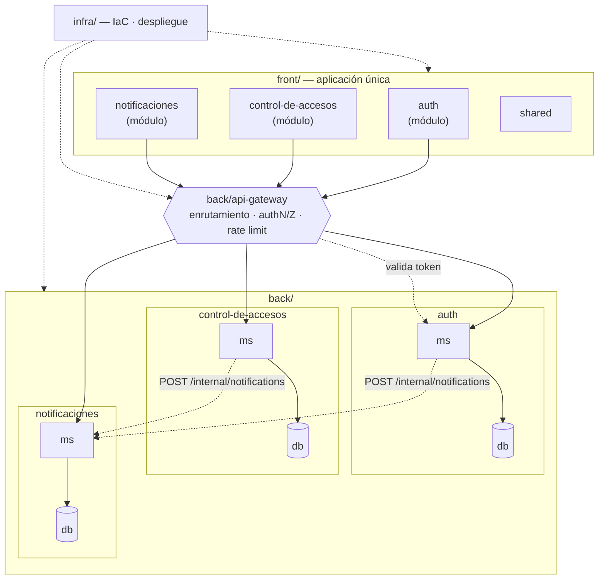

# SuperApp — Arquitectura

Un solo frontend con un módulo por feature. En el backend cada feature es
autónoma: su propio microservicio (`ms`) y su propia base de datos (`db`).
Ningún `ms` accede a la `db` de otro feature. Todo el tráfico del frontend
entra por el **API Gateway**, que enruta y valida antes de llegar a los
microservicios.

## Diagrama



## Estructura de carpetas

```
SuperApp/
├── back/
│   ├── api-gateway/             # servicio sin estado: no tiene db/
│   ├── control-de-accesos/
│   │   ├── ms/                  # microservicio de control de accesos
│   │   └── db/                  # esquema y migraciones propias
│   ├── auth/
│   │   ├── ms/
│   │   └── db/
│   └── notificaciones/
│       ├── ms/
│       └── db/
├── front/                       # una sola aplicación
│   └── src/
│       ├── modules/
│       │   ├── control-de-accesos/
│       │   ├── auth/
│       │   └── notificaciones/
│       └── shared/              # código común entre módulos
├── infra/
└── docs/
    ├── architecture.md
    ├── api-gateway.md       # contrato del gateway (por implementar)
    ├── control-de-accesos.md
    ├── events.md            # solicitudes de notificación entre servicios
    └── internal-apis.md     # endpoints /internal/* entre servicios
```

## Componentes

| Componente | Responsabilidad | Depende de |
|---|---|---|
| `front` | Aplicación única; un módulo de UI por feature | `api-gateway` |
| `back/api-gateway` | Punto de entrada único: enrutamiento, validación de token, rate limiting. Sin base de datos. | `auth` |
| `back/auth` | Identidad, credenciales, emisión y validación de tokens | — |
| [`back/control-de-accesos`](control-de-accesos.md) | Permisos, roles y registro de entradas/salidas | `auth` |
| `back/notificaciones` | Entrega de notificaciones: recibe solicitudes por `/internal/notifications`, bandeja, push (FCM), preferencias y tokens de dispositivos. Ver `back/notificaciones/README.md` | — |

## Convenciones

- `ms/` contiene el servicio desplegable del feature.
- `db/` contiene únicamente los artefactos de datos de ese feature
  (migraciones, semillas, esquema). En producción todos los features comparten
  una base de datos (RDS) y cada uno usa su propio schema y rol de Postgres.
- `api-gateway` no tiene `db/`: es sin estado por diseño.
- El frontend nunca llama a un `ms` directamente, siempre vía `api-gateway`.
- Las carpetas se mantienen en git con `.gitkeep` hasta que tengan código.
- Los endpoints entre servicios viven bajo `/internal/*`, nunca se exponen por el
  gateway y se autentican con `X-Internal-Secret` (ver `internal-apis.md`).
- Para notificar, un `ms` llama a `POST /internal/notifications` de
  notificaciones. Cada solicitud lleva un `event_id` y notificaciones es
  idempotente sobre él (ver `events.md`).
- Los `ms` confían en los headers de identidad (`X-User-ID`, `X-Complex-ID`,
  `X-Complex-Role`) que inyecta el `api-gateway`, protegidos con
  `X-Gateway-Secret` (ver `api-gateway.md`).
